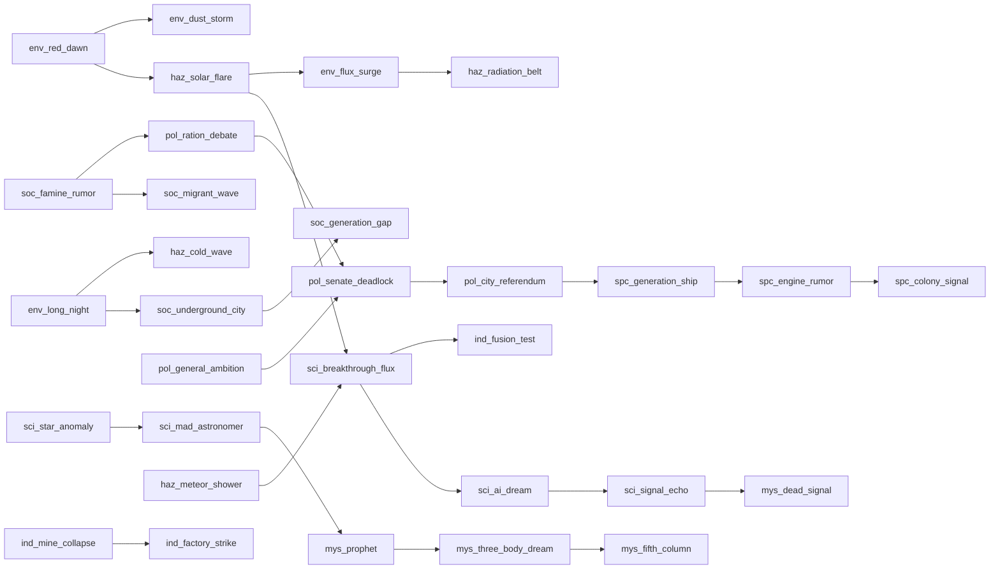

# 随机事件系统 v3 · EVENTS

> 规格来源：docs/EXPANSION_V3.md §2。模块：src/events/definitions.ts（内容）+ src/events/system.ts（逻辑）。
> 测试：tests/systems/events.test.ts。本文档由内容表与系统常量生成/校对，改事件后请同步刷新。

## 0. 内容规模

| 指标 | 数值 |
| --- | --- |
| 事件总数 | 64 |
| 类别 | 环境 8 · 社会 8 · 政治 8 · 科学 8 · 工业 8 · 航天 8 · 神秘 8 · 灾害 8 |
| 时代覆盖（按 eraMin/eraMax） | E1 20 · E2 37 · E3 50 · E4 48 · E5 35 |
| 每个事件选项数 | 3（2–3 合规；部分选项带 requirements） |
| followUp 链边 | 189 条（64/64 个事件带后续链） |
| CHAIN_INFLUENCE | 51 个来源事件 / 153 条显式乘数 |
| 插图契约 | `events/<id>.jpg`（art 侧按 id 生成） |

## 1. 与游戏层的集成契约（lead 用）

### 1.1 每回合调用顺序

```ts
import { createEventState, maybeTriggerEvent, resolveEventChoice, getActiveEvent, eventModifiersView } from "./events/system";

// 开新游戏 / 读旧档迁移
state.events = createEventState(state.meta.seed);

// civ 回合结算完成后（turn 已递增）
const ctx: EventContext = {
  civ: state.civ,
  tech: state.tech,
  politics: state.politics,
  hazards: state.hazards,
  era: state.civ.era,
  turn: state.civ.turn,
  year: state.yearsElapsed,
  difficulty: state.meta.difficulty,
  randomSeed: state.meta.seed,
};
const pending = maybeTriggerEvent(state.events, ctx);
if (pending) { /* 暂停时间，弹事件面板（getActiveEvent + eventModifiersView） */ }

// 玩家点选后
const result = resolveEventChoice(state.events, choiceId, ctx);
// result.effects 已经写入 ctx.civ / ctx.politics / ctx.hazards —— 不要再应用一次！
for (const log of result.logs) addLog(log.category, log.severity, log.message);
```

### 1.2 导出 API

| 函数 | 说明 |
| --- | --- |
| `createEventState(seed: string): EventState` | 初始化：pending 空、首触发回合 5–8、记录 seed。 |
| `maybeTriggerEvent(state, ctx): PendingEventState \| null` | 每回合调用；最多 1 个 pending。事件链到期时优先确定性触发。 |
| `resolveEventChoice(state, choiceId, ctx): EventResolution` | 结算；直接写 civ/politics/hazards/state；返回 logs/outcome/effectsSummary/followUp/historyEntry。 |
| `getActiveEvent(state): GameEventDef \| null` | 当前待处理事件定义（喂 ActiveEventView）。 |
| `eventModifiersView(state): {label,multiplier,tone}[]` | 喂 EventsView.modifiers（tag 修正 + 上一事件余波）。 |
| `eligibleEvents(ctx, state?): GameEventDef[]` | 当前条件可出场事件（测试/调试）。 |
| `eventCandidates(state, ctx): EventCandidate[]` | 可出场事件 + 最终权重分解（测试概率机制）。 |
| `checkRequirements(req, ctx, state?)` / `isChoiceAvailable(choice, ctx, state)` | 返回 {ok, reason}，喂 EventChoiceView.available/unavailableReason。 |
| `effectKeywords(effects): string[]` | 选项效果关键词，喂 EventChoiceView.preview。 |
| `scheduledEventsView(state): ScheduledEvent[]` | 已排期的事件链（UI 时间线 / 调试）。 |
| `applyEventEffects(state, def, choice, ctx)` | 效果落地（含上限夹紧），resolve 内部使用。 |
| 常量 | `CHAIN_INFLUENCE / EVENT_EFFECT_CAPS / MAX_PENDING_EVENTS / MODIFIER_DECAY` 等 |

### 1.3 效果应用约定

- 与 lead 约定：**本系统直接修改传入对象**（civ / politics / hazards），resolveEventChoice 返回的 effects 仅用于展示/日志，**不要重复应用**。
- resources 通过 civilization.gainResource 写入并自动夹到 [0, capacity]；population 同步 workforce；stability 写入 civ.stability（0–100）；capital 写入 politics.capital；hazardStress 写入 hazards.stress；relation 写入 politics.relations；flags 写入 EventState.flags。
- 所有写入都先做 Number.isFinite 守卫与 clamp，不允许 NaN/Infinity 进入状态。

### 1.4 EventState 扩展字段（declare module，未改 core/types.ts）

| 字段 | 类型 | 用途 |
| --- | --- | --- |
| `eventSeed?` | string | createEventState 的种子；ctx.randomSeed 缺省时回退，保证可复现。 |
| `chainQueue?` | ScheduledEvent[] | followUp 延迟排期（不占 pending，最多 8 条）；旧档缺字段自动补 []。 |
| `modifierTurn?` | number | 概率修正已衰减到的回合，避免重复衰减。 |

pending 恒 ≤ 1；history 上限 80 条；lastEventIds 记忆 6 个。

### 1.5 视图映射（src/game/viewTypes.ts）

| EventsView 字段 | 来源 |
| --- | --- |
| active | getActiveEvent(state) + 选项 isChoiceAvailable/effectKeywords 组装 |
| pendingCount | state.pending.length |
| history | state.history → EventHistoryView（choiceLabel/outcome/illustration） |
| modifiers | eventModifiersView(state) |
| totalTriggered | state.triggeredTotal |
| lastEventTitle | state.lastEventIds 最后一个 → getEventDef().title |

## 2. 概率机制

### 2.1 触发节拍

- 首次事件：第 `FIRST_EVENT_TURN_MIN(5)` + 0–3 回合。
- 常规间隔：20–34 回合，按难度修正（easy +2 / normal 0 / hard −2 / nightmare −3）与时代修正（E2+ −1 / E4+ −2），夹在 5–20。
- 到期时才抽签；pending 非空时不再触发（最多 1 个事件弹窗）。
- 抽到的事件立即写入 pending 并记为 triggered（seenCounts+1、lastEventIds 更新、triggeredTotal+1）。

### 2.2 加权抽签公式

```
weight(def) = baseWeight
            × Π tagModifier[tag]        // 选择写入、向 1 衰减的概率修正
            × chainMultiplier           // CHAIN_INFLUENCE[上一事件][def.id]
            × repeatMultiplier          // 0.55^seenCounts，下限 0.15
            × difficultyCategoryMult    // hazard: easy 0.85 / hard 1.15 / nightmare 1.3；mystery: easy 0.9 / nightmare 1.15

P(def) = weight(def) / Σ weight(所有可出场事件)
```

可出场 = 时代区间 + 事件 requirements + 非重复事件未见过 + 不在冷却中。

### 2.3 tag modifiers（上一回合事件 → 下一回合概率）

- 选项 effects.influence 写 `state.modifiers[tag] = clamp(existing × multiplier, 0.1, 4)`。
- 每个新回合向中性值 1 衰减：`next = 1 + (raw − 1) × 0.65^Δturn`；|next−1| < 0.02 时删除。
- 关键：**向 1 衰减，不是向 0 指数衰减**（否则 1.8 会在几回合后变成 0.1，等于永久压制该 tag 事件）。
- 事件 weight 会乘上它所有 tags 的 modifier；因此“饥荒”选择会让后续带 famine 标签的事件更常出现，再逐步回到常态。
- eventModifiersView 把当前非 1 的 tag 修正以中文标签 + 倍率 + up/down 展示给玩家。

### 2.4 CHAIN_INFLUENCE（显式“上一事件影响下一事件概率”）

- 51 个来源事件、共 153 条乘数，见 §3.2 全表。
- 抽签时读取最近 6 个 lastEventIds 中的**最后 2 个**：最近事件乘数全额，较早事件取平方根（衰减），夹在 0.2–3。
- 与 modifiers 的区别：modifiers 是 tag 维度衰减；CHAIN_INFLUENCE 是事件 id 维度显式因果，不随时间衰减，但只对“最近发生”的事件生效。

### 2.5 followUps（事件链排期）

- 每个选择结算后，按 weight 加权从 `def.followUps` 中选 1 条，按 delayTurns（1–4，夹紧）写入 chainQueue；同时满足 requirements 的候选才参与。
- 到期时 **优先且确定地** 触发（不走加权抽签），保证事件链可测试、可复现；队列上限 8，超出丢最旧。
- 到期事件若时代/条件不满足则丢弃该链，回落到正常抽签节拍。
- pending 仍 ≤ 1（链排期不占 pending）。

### 2.6 冷却 / 重复 / 历史

- cooldownTurns：结算后设置 cooldowns[id] = turn + cooldownTurns；到期自动清理。
- repeatable: false 的事件出现过一次后不再出场（seenCounts 判定），同时设置一格冷却兜底。
- 重复事件 per-seen 衰减 0.55^n（下限 0.15）。
- 历史 EventHistoryEntry 记录 defId/title/category/turn/year/choice/outcome/illustration/effectsSummary，上限 80。

### 2.7 确定性（seed 可复现）

- 所有随机数来自 core/rng 的 Mulberry32，种子为 `hash(seed|阶段|turn|triggeredTotal|ctx.randomSeed)`；不使用 Math.random。
- 同一 seed + 同一 ctx.turn / civ 状态 / 选择序列 → 完全相同的触发与结果（测试已覆盖）。

## 3. 效果与上限

| 效果 | 单次硬上限 | 说明 |
| --- | --- | --- |
| 人口 population / populationPct | ±8%（合计） | 人口最低保留 1；不会单次灭国 |
| 稳定度 stability | ±12 | civ.stability 夹到 0–100 |
| 资源 resources / science | ±8% × 基础容量 | 食物 ±320 / 水 ±240 / 能源 ±200 / 矿物 ±200 / 金属 ±144 / 科研点 ±1600 |
| 政治资本 capital | ±15 | politics.capital ≥ 0 |
| 部门关系 relation | ±25 | -100..100 |
| 灾害压力 hazardStress | ±20 | 0..100 |
| influence 乘数 | 0.2–3 | 累积后 state.modifiers 夹到 0.1–4 |

数值在 definitions 侧已按规格书写（测试逐条校验），system 侧再夹一次作为运行时保险；absurd 输入也不会产生 NaN/Infinity（测试覆盖）。

## 4. 事件链图

### 4.1 主干链（节选，完整邻接见 4.2）



### 4.2 全量事件链邻接表

> 括号内为 followUp 权重 ×延迟回合。

| 事件 | 后续链 |
| --- | --- |
| env_red_dawn | env_dust_storm（×3 +2）、haz_solar_flare（×2 +1） |
| env_long_night | haz_cold_wave（×4 +2）、soc_underground_city（×2 +3） |
| env_ice_river | haz_flood（×3 +2）、haz_cold_wave（×2 +2）、ind_rail_line（×1 +4） |
| soc_harvest_feast | soc_birth_boom（×4 +3）、pol_hero_statue（×2 +2） |
| soc_famine_rumor | pol_ration_debate（×4 +2）、soc_migrant_wave（×3 +2）、haz_plague（×2 +3） |
| soc_dehydrated_cult | mys_prophet（×5 +2）、mys_three_body_dream（×2 +4）、pol_hero_statue（×2 +3） |
| pol_ration_debate | pol_senate_deadlock（×3 +2）、soc_migrant_wave（×3 +2）、soc_dehydrated_cult（×1 +3） |
| pol_scholar_appeal | pol_senate_deadlock（×3 +2）、sci_breakthrough_flux（×3 +3）、soc_school_wars（×3 +2） |
| pol_hero_statue | soc_harvest_feast（×3 +2）、pol_succession_quarrel（×2 +3）、soc_school_wars（×2 +3） |
| sci_star_anomaly | sci_mad_astronomer（×5 +2）、mys_listening_stars（×3 +2）、sci_breakthrough_flux（×2 +3） |
| sci_mad_astronomer | mys_prophet（×4 +1）、sci_calculator_cult（×3 +3）、mys_time_loop（×1 +4） |
| sci_lost_archives | sci_calculator_cult（×4 +2）、mys_impossible_ruin（×2 +3）、sci_breakthrough_flux（×3 +2） |
| ind_mine_collapse | ind_factory_strike（×4 +2）、pol_scholar_appeal（×2 +2）、haz_quake（×2 +3） |
| ind_rail_line | soc_harvest_feast（×3 +2）、ind_scrap_windfall（×3 +2）、soc_migrant_wave（×2 +3） |
| spc_generation_ship | spc_engine_rumor（×4 +2）、spc_colony_signal（×2 +3）、pol_city_referendum（×2 +2） |
| spc_deep_probe | mys_dead_signal（×4 +3）、sci_signal_echo（×4 +2）、spc_colony_signal（×2 +3） |
| mys_listening_stars | mys_prophet（×3 +2）、sci_star_anomaly（×3 +2）、mys_impossible_ruin（×2 +3） |
| mys_prophet | mys_three_body_dream（×5 +2）、soc_dehydrated_cult（×3 +2）、mys_time_loop（×1 +4） |
| haz_solar_flare | env_flux_surge（×4 +1）、sci_breakthrough_flux（×2 +2）、env_red_dawn（×2 +2） |
| haz_meteor_shower | sci_breakthrough_flux（×4 +2）、mys_impossible_ruin（×2 +2）、ind_mine_collapse（×2 +3） |
| env_dust_storm | haz_solar_flare（×2 +2）、ind_mine_collapse（×2 +2）、env_red_dawn（×2 +3） |
| env_flux_surge | haz_radiation_belt（×3 +2）、sci_gene_lab_leak（×3 +2）、ind_steam_overheat（×2 +2） |
| env_quiet_spring | soc_harvest_feast（×4 +2）、soc_birth_boom（×3 +2）、sci_breakthrough_flux（×2 +3） |
| soc_birth_boom | pol_ration_debate（×3 +3）、ind_rail_line（×2 +3）、soc_school_wars（×3 +2） |
| soc_migrant_wave | pol_succession_quarrel（×3 +2）、ind_factory_strike（×2 +2）、pol_corruption_ring（×2 +3） |
| soc_school_wars | sci_lost_archives（×3 +2）、pol_scholar_appeal（×3 +2）、sci_calculator_cult（×2 +3） |
| pol_succession_quarrel | pol_general_ambition（×4 +2）、pol_corruption_ring（×2 +2）、soc_migrant_wave（×2 +3） |
| pol_general_ambition | pol_senate_deadlock（×4 +2）、pol_city_referendum（×2 +2）、haz_fire（×1 +3） |
| pol_corruption_ring | pol_senate_deadlock（×4 +2）、ind_factory_strike（×2 +2）、soc_migrant_wave（×2 +3） |
| sci_breakthrough_flux | ind_fusion_test（×3 +3）、spc_deep_probe（×2 +3）、sci_ai_dream（×3 +2） |
| sci_calculator_cult | mys_fifth_column（×3 +2）、sci_ai_dream（×4 +2）、pol_scholar_appeal（×2 +3） |
| sci_signal_echo | mys_dead_signal（×4 +2）、spc_colony_signal（×3 +2）、sci_ai_dream（×2 +3） |
| ind_smelter_spore | haz_plague（×3 +2）、ind_factory_strike（×3 +2）、env_green_rain（×2 +3） |
| ind_steam_overheat | haz_fire（×3 +1）、ind_power_cut（×3 +2）、haz_quake（×1 +3） |
| ind_power_cut | pol_ration_debate（×3 +2）、soc_underground_city（×2 +2）、ind_steam_overheat（×2 +2） |
| spc_orbit_debris | spc_moon_quarantine（×4 +2）、spc_orbital_elevator（×2 +2）、haz_radiation_belt（×2 +3） |
| spc_moon_quarantine | spc_orbit_debris（×3 +2）、pol_senate_deadlock（×2 +2）、mys_dead_signal（×1 +3） |
| spc_orbital_elevator | spc_engine_rumor（×3 +2）、spc_deep_probe（×2 +2）、env_tidal_heating（×2 +3） |
| mys_impossible_ruin | mys_dead_signal（×4 +2）、spc_deep_probe（×3 +2）、sci_lost_archives（×2 +3） |
| mys_time_loop | mys_three_body_dream（×3 +2）、sci_ai_dream（×2 +2）、mys_prophet（×2 +3） |
| mys_dead_signal | mys_fifth_column（×3 +2）、sci_signal_echo（×2 +2）、mys_time_loop（×2 +3） |
| haz_quake | ind_mine_collapse（×3 +2）、haz_flood（×2 +2）、pol_succession_quarrel（×2 +3） |
| haz_flood | ind_rail_line（×2 +2）、haz_plague（×3 +2）、env_green_rain（×2 +3） |
| haz_plague | sci_gene_lab_leak（×3 +3）、soc_generation_gap（×2 +2）、pol_ration_debate（×2 +2） |
| env_green_rain | haz_plague（×3 +2）、ind_smelter_spore（×2 +2）、env_ice_river（×2 +3） |
| env_tidal_heating | env_flux_surge（×3 +2）、haz_quake（×3 +2）、ind_steam_overheat（×2 +3） |
| soc_underground_city | env_long_night（×3 +3）、soc_generation_gap（×3 +2）、pol_corruption_ring（×2 +3） |
| soc_generation_gap | pol_city_referendum（×3 +2）、mys_fifth_column（×2 +2）、sci_calculator_cult（×2 +3） |
| pol_city_referendum | spc_generation_ship（×4 +2）、spc_colony_signal（×2 +2）、soc_generation_gap（×2 +3） |
| pol_senate_deadlock | pol_city_referendum（×4 +2）、soc_generation_gap（×2 +2）、pol_corruption_ring（×2 +3） |
| sci_gene_lab_leak | haz_plague（×3 +2）、env_flux_surge（×2 +3）、sci_ai_dream（×2 +2） |
| sci_ai_dream | sci_signal_echo（×3 +2）、spc_colony_signal（×2 +2）、mys_dead_signal（×2 +3） |
| ind_factory_strike | pol_general_ambition（×3 +2）、soc_generation_gap（×2 +2）、ind_power_cut（×2 +3） |
| ind_scrap_windfall | ind_fusion_test（×3 +2）、ind_power_cut（×2 +2）、spc_orbital_elevator（×1 +3） |
| ind_fusion_test | env_tidal_heating（×2 +3）、spc_generation_ship（×3 +2）、ind_power_cut（×2 +2） |
| spc_colony_signal | mys_dead_signal（×3 +2）、pol_city_referendum（×2 +2）、spc_engine_rumor（×2 +3） |
| spc_meteor_swarm | haz_meteor_shower（×4 +1）、spc_orbit_debris（×2 +2）、env_dust_storm（×2 +2） |
| spc_engine_rumor | spc_generation_ship（×3 +2）、pol_city_referendum（×2 +2）、env_tidal_heating（×2 +3） |
| mys_three_body_dream | mys_fifth_column（×3 +2）、mys_dead_signal（×2 +2）、sci_star_anomaly（×2 +3） |
| mys_fifth_column | pol_city_referendum（×3 +2）、mys_dead_signal（×3 +2）、soc_generation_gap（×2 +3） |
| mys_frozen_astronomer | sci_lost_archives（×3 +2）、mys_listening_stars（×3 +2）、soc_dehydrated_cult（×2 +3） |
| haz_cold_wave | soc_underground_city（×3 +2）、ind_power_cut（×2 +2）、env_long_night（×2 +3） |
| haz_fire | ind_factory_strike（×2 +2）、ind_power_cut（×2 +2）、pol_ration_debate（×2 +3） |
| haz_radiation_belt | sci_gene_lab_leak（×3 +2）、env_flux_surge（×3 +2）、ind_power_cut（×2 +3） |

### 4.3 CHAIN_INFLUENCE 全表

| 上一事件 | 提升的下一事件（乘数） |
| --- | --- |
| env_red_dawn | env_dust_storm（×1.7）、haz_solar_flare（×1.5）、env_flux_surge（×1.4） |
| env_long_night | haz_cold_wave（×1.9）、soc_underground_city（×1.4）、ind_power_cut（×1.3） |
| env_ice_river | haz_flood（×1.6）、haz_cold_wave（×1.4）、ind_rail_line（×1.2） |
| env_quiet_spring | soc_harvest_feast（×1.8）、soc_birth_boom（×1.5）、sci_breakthrough_flux（×1.2） |
| env_flux_surge | haz_radiation_belt（×1.5）、sci_gene_lab_leak（×1.4）、ind_steam_overheat（×1.2） |
| soc_harvest_feast | soc_birth_boom（×1.7）、pol_hero_statue（×1.4）、env_quiet_spring（×1.2） |
| soc_birth_boom | pol_ration_debate（×1.4）、ind_rail_line（×1.3）、soc_school_wars（×1.2） |
| soc_famine_rumor | pol_ration_debate（×1.9）、haz_plague（×1.5）、soc_migrant_wave（×1.6） |
| soc_dehydrated_cult | mys_prophet（×1.6）、mys_three_body_dream（×1.4）、pol_hero_statue（×1.2） |
| soc_migrant_wave | pol_succession_quarrel（×1.4）、ind_factory_strike（×1.3）、pol_corruption_ring（×1.2） |
| soc_generation_gap | pol_city_referendum（×1.5）、mys_fifth_column（×1.3）、sci_calculator_cult（×1.2） |
| pol_ration_debate | soc_migrant_wave（×1.7）、pol_senate_deadlock（×1.6）、soc_dehydrated_cult（×1.3） |
| pol_general_ambition | pol_senate_deadlock（×1.8）、pol_city_referendum（×1.2）、haz_fire（×1.2） |
| pol_senate_deadlock | pol_city_referendum（×1.9）、soc_generation_gap（×1.3）、pol_corruption_ring（×1.4） |
| pol_city_referendum | spc_generation_ship（×1.7）、spc_colony_signal（×1.2）、soc_generation_gap（×1.3） |
| pol_hero_statue | soc_harvest_feast（×1.5）、pol_succession_quarrel（×1.3）、soc_school_wars（×1.2） |
| pol_corruption_ring | pol_senate_deadlock（×1.6）、ind_factory_strike（×1.3）、soc_migrant_wave（×1.2） |
| pol_scholar_appeal | pol_senate_deadlock（×1.3）、sci_breakthrough_flux（×1.4）、soc_school_wars（×1.5） |
| pol_succession_quarrel | pol_general_ambition（×1.8）、pol_corruption_ring（×1.3）、soc_migrant_wave（×1.2） |
| sci_star_anomaly | sci_mad_astronomer（×1.9）、mys_listening_stars（×1.5）、sci_breakthrough_flux（×1.3） |
| sci_mad_astronomer | mys_prophet（×1.8）、sci_calculator_cult（×1.5）、mys_time_loop（×1.2） |
| sci_lost_archives | sci_calculator_cult（×1.8）、mys_impossible_ruin（×1.3）、sci_breakthrough_flux（×1.4） |
| sci_breakthrough_flux | ind_fusion_test（×1.6）、spc_deep_probe（×1.4）、sci_ai_dream（×1.3） |
| sci_calculator_cult | mys_fifth_column（×1.4）、sci_ai_dream（×1.7）、pol_scholar_appeal（×1.2） |
| sci_ai_dream | sci_signal_echo（×1.8）、spc_colony_signal（×1.4）、mys_dead_signal（×1.3） |
| ind_mine_collapse | ind_factory_strike（×1.8）、pol_scholar_appeal（×1.3）、haz_quake（×1.4） |
| ind_factory_strike | pol_general_ambition（×1.4）、soc_generation_gap（×1.5）、ind_power_cut（×1.3） |
| ind_power_cut | pol_ration_debate（×1.5）、soc_underground_city（×1.3）、ind_steam_overheat（×1.2） |
| ind_rail_line | soc_harvest_feast（×1.4）、ind_scrap_windfall（×1.5）、soc_migrant_wave（×1.2） |
| ind_steam_overheat | haz_fire（×1.5）、ind_power_cut（×1.4）、haz_quake（×1.1） |
| ind_fusion_test | env_tidal_heating（×1.4）、spc_generation_ship（×1.4）、ind_power_cut（×1.2） |
| spc_generation_ship | spc_engine_rumor（×1.9）、spc_colony_signal（×1.5）、pol_city_referendum（×1.3） |
| spc_deep_probe | mys_dead_signal（×1.6）、sci_signal_echo（×1.5）、spc_colony_signal（×1.2） |
| spc_orbit_debris | spc_moon_quarantine（×1.8）、spc_orbital_elevator（×1.4）、haz_radiation_belt（×1.3） |
| spc_colony_signal | pol_city_referendum（×1.3）、mys_dead_signal（×1.4）、spc_engine_rumor（×1.2） |
| spc_meteor_swarm | haz_meteor_shower（×1.7）、spc_orbit_debris（×1.4）、env_dust_storm（×1.2） |
| spc_engine_rumor | pol_city_referendum（×1.5）、spc_orbital_elevator（×1.2）、soc_generation_gap（×1.2） |
| mys_listening_stars | mys_dead_signal（×1.8）、sci_signal_echo（×1.5）、mys_impossible_ruin（×1.3） |
| mys_prophet | mys_three_body_dream（×2）、soc_dehydrated_cult（×1.7）、mys_time_loop（×1.2） |
| mys_three_body_dream | mys_fifth_column（×1.5）、mys_dead_signal（×1.4）、sci_star_anomaly（×1.3） |
| mys_impossible_ruin | mys_dead_signal（×1.6）、spc_deep_probe（×1.5）、sci_lost_archives（×1.2） |
| mys_frozen_astronomer | sci_lost_archives（×1.7）、mys_listening_stars（×1.4）、soc_dehydrated_cult（×1.2） |
| mys_dead_signal | mys_fifth_column（×1.3）、sci_signal_echo（×1.2）、mys_time_loop（×1.2） |
| haz_solar_flare | env_flux_surge（×2.2）、sci_breakthrough_flux（×1.5）、env_red_dawn（×1.6） |
| haz_meteor_shower | sci_breakthrough_flux（×1.8）、mys_impossible_ruin（×1.4）、ind_mine_collapse（×1.3） |
| haz_quake | ind_mine_collapse（×1.9）、pol_succession_quarrel（×1.2）、haz_flood（×1.4） |
| haz_flood | env_ice_river（×1.5）、ind_smelter_spore（×1.6）、soc_migrant_wave（×1.4） |
| haz_plague | sci_gene_lab_leak（×1.6）、soc_generation_gap（×1.3）、pol_ration_debate（×1.4） |
| haz_cold_wave | soc_underground_city（×1.7）、ind_power_cut（×1.6）、env_long_night（×1.5） |
| haz_fire | ind_factory_strike（×1.4）、ind_power_cut（×1.3）、soc_generation_gap（×1.2） |
| haz_radiation_belt | sci_gene_lab_leak（×1.5）、sci_signal_echo（×1.3）、spc_orbit_debris（×1.4） |

## 5. 全事件表

| id | 标题 | 类别 | 时代 | 权重 | 摘要 | tags |
| --- | --- | --- | --- | --- | --- | --- |
| env_red_dawn | 赤色黎明 | 环境 | E1–E5 | 16 | 三颗太阳同时越过地平线，白昼被烧成一片赤红。 | heat / storm / fear |
| env_long_night | 长夜 | 环境 | E1–E5 | 15 | 太阳落下后就再也没有升起，黑暗已经持续了十一个昼夜。 | dark / cold / fear |
| env_ice_river | 冰河倒灌 | 环境 | E1–E3 | 12 | 上游冰川在夜里裂开，整条河被推上河岸，冰墙长到三人高。 | cold / flood / fear |
| soc_harvest_feast | 丰收祭 | 社会 | E1–E3 | 14 | 连续两个稳定季风之后，粮仓第一次装满了。 | harvest / hope / unity |
| soc_famine_rumor | 饥荒谣言 | 社会 | E1–E4 | 13 | 北边山谷传来粮仓见底的消息，集市粮价一夜翻了三倍。 | famine / fear / protest |
| soc_dehydrated_cult | 脱水教派 | 社会 | E1–E3 | 11 | 一群人宣称肉体是暂时的，只要脱水就能在下一个恒纪元醒来。 | cult / mystery / fear |
| pol_ration_debate | 配给辩论 | 政治 | E2–E4 | 13 | 粮仓只够再撑六个回合，议事棚里三种声音争执了一夜。 | ration / protest / famine |
| pol_scholar_appeal | 学者请愿 | 政治 | E1–E3 | 12 | 三名观星者跪求把修城墙的钱挪去建观星台。 | science / protest / reform |
| pol_hero_statue | 英雄雕像 | 政治 | E1–E3 | 10 | 第一位在长夜里点亮灯塔的观星者死了，该由谁被记住？ | unity / tradition / protest |
| sci_star_anomaly | 异常星光 | 科学 | E1–E3 | 12 | 一个不在任何恒星轨迹上的亮点，每隔十一夜出现一次。 | anomaly / science / mystery |
| sci_mad_astronomer | 疯狂观测者 | 科学 | E2–E4 | 11 | 那位三年没下塔的观测者，说三颗太阳之间还有第四种力量。 | anomaly / science / mystery |
| sci_lost_archives | 失落观测记录 | 科学 | E1–E3 | 10 | 地窖里翻出三百年前的星图，最关键的几页被人刻意刮掉。 | archive / science / mystery |
| ind_mine_collapse | 矿难 | 工业 | E2–E4 | 12 | 矿道在换班时分塌了，十三个人被困在竖井另一侧。 | industry / fear / protest |
| ind_rail_line | 机道贯通 | 工业 | E2–E4 | 12 | 连接矿场与粮仓的机道贯通，流民开始沿铁轨聚集。 | industry / hope / migration |
| spc_generation_ship | 世代飞船提案 | 航天 | E4–E5 | 10 | 工程师提交三百页方案：造一艘飞船，让下一代出生在星海里。 | space / hope / fear |
| spc_deep_probe | 深空探测器 | 航天 | E4–E5 | 10 | 探测器传回一段干净的信号，频率稳定得不像自然现象。 | space / signal / discovery |
| mys_listening_stars | 星语 | 神秘 | E1–E3 | 10 | 孩子们开始做同一个梦：三颗太阳围成一个圆，然后同时熄灭。 | mystery / anomaly / cult |
| mys_prophet | 预言者 | 神秘 | E1–E4 | 11 | 一个从未离开村子的人，忽然开始说出下一年才该发生的事。 | prophet / cult / fear |
| haz_solar_flare | 日冕爆发 | 灾害 | E1–E5 | 15 | 三颗太阳同时爆发，灼白的日冕正朝着母星抛来。 | radiation / heat / storm |
| haz_meteor_shower | 陨石雨 | 灾害 | E1–E5 | 14 | 夜空被撕成许多道金红的裂口，最近的陨坑离粮仓只隔一条河。 | meteor / ruin / fear |
| env_dust_storm | 尘暴过境 | 环境 | E2–E4 | 12 | 遮天蔽日的尘暴从北荒压来，能见度只剩三步。 | storm / fear / industry |
| env_flux_surge | 辐照潮汐 | 环境 | E1–E5 | 13 | 恒星光度在三个时辰里涨了近一倍，作物长出畸形的穗。 | radiation / gene / fear |
| env_quiet_spring | 静默的春天 | 环境 | E1–E5 | 12 | 一个没有风、没有尘暴、也没有异常辐照的春天。 | hope / harvest / unity |
| soc_birth_boom | 婴儿潮 | 社会 | E2–E4 | 12 | 饥荒之后的第五年，产房里第一次排起了长队。 | hope / harvest / famine |
| soc_migrant_wave | 流民潮 | 社会 | E2–E4 | 13 | 第一支流民队伍出现在城门口，身后跟着三百多人和空粮袋。 | migration / famine / protest |
| soc_school_wars | 学园论战 | 社会 | E2–E3 | 11 | 学园分裂成两派：一派要观测，一派要计算。 | science / tradition / protest |
| pol_succession_quarrel | 继承之争 | 政治 | E2–E4 | 12 | 执政长老在秋分去世，留下两个互相仇视的学生。 | protest / order / tradition |
| pol_general_ambition | 将军的野心 | 政治 | E3–E5 | 11 | 边境守军总督在冬夜检阅时，宣布需要更集权的秩序。 | military / fear / protest |
| pol_corruption_ring | 贪腐环 | 政治 | E2–E5 | 11 | 粮仓、矿场与驿站之间，出现了一条看不见的输送带。 | corruption / protest / reform |
| sci_breakthrough_flux | 辐照数据突破 | 科学 | E2–E4 | 12 | 观测者在辐照记录里发现一个周期，与三曜的相对位置完全咬合。 | discovery / science / anomaly |
| sci_calculator_cult | 演算崇拜 | 科学 | E3–E5 | 10 | 一群人开始向超算中心献祭，请求它替文明算出一个未来。 | ai / mystery / cult |
| sci_signal_echo | 信号回波 | 科学 | E4–E5 | 10 | 探测器发回的信号，比它应该返回的时间晚了整整一刻钟。 | signal / mystery / discovery |
| ind_smelter_spore | 冶炼疫病 | 工业 | E2–E3 | 11 | 冶炼厂的工人开始咳出带金属光泽的痰，孩子也跟着咳。 | plague / industry / fear |
| ind_steam_overheat | 蒸汽机过热 | 工业 | E3–E4 | 10 | 新装的高压蒸汽机在夜班时炸了，飞出的铁片削掉半间厂房。 | industry / fire / fear |
| ind_power_cut | 停电 | 工业 | E3–E5 | 12 | 电网在深夜断成三截，地下城和观测台同时陷入黑暗。 | industry / dark / protest |
| spc_orbit_debris | 轨道碎片 | 航天 | E4–E5 | 10 | 一场爆炸让近地轨道布满碎片，卫星只能不断躲闪。 | space / storm / fear |
| spc_moon_quarantine | 卫星隔离协议 | 航天 | E4–E5 | 10 | 轨道站里出现一种只在失重下传播的怪病，地面开始讨论封锁。 | space / colony / plague |
| spc_orbital_elevator | 轨道电梯 | 航天 | E5–E5 | 9 | 一根从赤道升向太空的缆索第一次被完整地拉直。 | space / hope / industry |
| mys_impossible_ruin | 不可能的建筑遗迹 | 神秘 | E2–E4 | 11 | 荒原深处出现一座建筑，它的墙体比任何已知工具都更平滑。 | ruin / mystery / discovery |
| mys_time_loop | 循环之夜 | 神秘 | E3–E5 | 9 | 整座城在同一天醒来三次：钟表、日记、伤口都回到了原处。 | anomaly / mystery / fear |
| mys_dead_signal | 死寂频段 | 神秘 | E4–E5 | 10 | 深空频段在某一天彻底安静下来，像有人关掉了宇宙的背景声。 | signal / mystery / fear |
| haz_quake | 地动 | 灾害 | E2–E5 | 13 | 大地在半夜裂开，矿区的房屋成片塌进地缝。 | quake / ruin / fear |
| haz_flood | 洪水 | 灾害 | E1–E3 | 13 | 连日暴雨之后，河堤在黎明前决口，水头冲进了下城。 | flood / storm / fear |
| haz_plague | 疫病 | 灾害 | E2–E4 | 12 | 一种没有名字的发热病从矿工棚传进城，三天内倒下两百人。 | plague / fear / protest |
| env_green_rain | 绿雨 | 环境 | E1–E3 | 11 | 雨下了七天，落在地上泛着病态的油绿，不肯停。 | flood / plague / storm |
| env_tidal_heating | 潮汐加热 | 环境 | E3–E5 | 9 | 地下的热量在三个昼夜里上涌，冻土融化，矿井深处热得无法作业。 | radiation / quake / industry |
| soc_underground_city | 地下城生活 | 社会 | E3–E5 | 11 | 为了躲开极端气候，第一批人搬进了地下，一住就是整整七年。 | underground / hope / fear |
| soc_generation_gap | 世代隔阂 | 社会 | E3–E5 | 10 | 地下出生的一代人和地面出生的一代人，已经无法理解彼此。 | protest / tradition / hope |
| pol_city_referendum | 城市公投 | 政治 | E4–E5 | 10 | 是否把整座城市的未来押上飞船，议事棚决定交由全民公投。 | reform / protest / space |
| pol_senate_deadlock | 议会僵局 | 政治 | E3–E5 | 11 | 两派在议事棚里对峙已十四天，任何议案都无法通过。 | order / protest / reform |
| sci_gene_lab_leak | 基因实验室泄漏 | 科学 | E4–E5 | 10 | 培养舱的密封在夜里失效，试验菌落漂进了通风系统。 | gene / plague / fear |
| sci_ai_dream | 模型之梦 | 科学 | E4–E5 | 10 | 超算在无人输入的情况下，连续七夜输出了同一张星图。 | ai / mystery / discovery |
| ind_factory_strike | 工人停工 | 工业 | E3–E5 | 12 | 三座工厂同时停工，工人要求缩短轮班并公布死亡名单。 | strike / protest / industry |
| ind_scrap_windfall | 废料横财 | 工业 | E3–E4 | 10 | 旧工业废墟下，挖出一批尚未锈透的合金件。 | industry / hope / luck |
| ind_fusion_test | 聚变点火 | 工业 | E5–E5 | 9 | 第一座聚变实验堆在黎明前点火成功，整座城安静了三秒。 | industry / hope / science |
| spc_colony_signal | 殖民地失联 | 航天 | E4–E5 | 9 | 母星之外的第一个殖民地在例行通讯时突然安静。 | colony / signal / fear |
| spc_meteor_swarm | 流星群 | 航天 | E4–E5 | 10 | 探测器发现一片正在靠近的流星群，规模足以在半年内持续落石。 | meteor / space / fear |
| spc_engine_rumor | 行星发动机传闻 | 航天 | E5–E5 | 9 | 工程院流出一份蓝图：在母星上建造能推动整颗行星的发动机。 | engine / space / fear |
| mys_three_body_dream | 三体之梦 | 神秘 | E2–E5 | 11 | 全城居民在同一夜梦见三颗太阳的完整轨道，醒来后画出同一张图。 | anomaly / mystery / fear |
| mys_fifth_column | 第五纵队 | 神秘 | E3–E5 | 9 | 一个地下组织声称，三颗太阳中有一颗是他们的眼，人类应停止一切观测。 | protest / mystery / fear |
| mys_frozen_astronomer | 冰冻的观星者 | 神秘 | E1–E3 | 10 | 冰川深处挖出一具保持坐姿的观星者，身边星图仍清晰可读。 | mystery / archive / ruin |
| haz_cold_wave | 寒潮 | 灾害 | E1–E5 | 13 | 气温在两天里掉了四十度，河水冻到可以直接走人。 | cold / famine / fear |
| haz_fire | 大火 | 灾害 | E2–E4 | 12 | 粮仓在深夜起火，风把火舌甩到了半座城的屋顶上。 | fire / ruin / fear |
| haz_radiation_belt | 辐射带 | 灾害 | E3–E5 | 11 | 母星穿进一片强辐射带，裸露三个回合会让所有电子设备报废。 | radiation / plague / fear |

## 6. 维护指南

新增/修改事件时必须保持（tests/systems/events.test.ts 会逐条校验）：

1. `id` 全局唯一，命名 `<类别前缀>_<英文短名>`；插图固定 `events/<id>.jpg`。
2. 8 类别之一；eraMin/eraMax 在 1–5 且 min ≤ max；weight > 0；tags 非空。
3. short 20–40 字，body 120–220 字（可选 longBody 250–450 字），中文文案有世界观质感，禁止 TODO/占位。
4. 每事件 2–3 个选择，字段齐全（label/description/outcome/effects），选项 id 事件内唯一。
5. effects 不超过 §3 上限；influence 乘数 0.2–3；requirements 的科技 id 必须真实存在，flag 必须有事件能写入。
6. followUps 只引用真实事件 id，delayTurns 1–4；新增链请同步补充/校验 CHAIN_INFLUENCE。
7. 改完跑：`node .\node_modules\typescript\bin\tsc --noEmit` 与 `node .\node_modules\vitest\vitest.mjs run tests/systems/events.test.ts`。

## 7. 测试覆盖（tests/systems/events.test.ts，27 例）

- 内容完整性：数量 ≥60、id 唯一、8 类别、每回合时代可出场 ≥4、文本长度、插图路径、无占位符；
- 选择与效果：2–3 选项/字段完整/效果上限/数值有限；
- 逻辑关联：followUp 引用与延迟、链边 ≥15、CHAIN_INFLUENCE ≥25 且引用真实 id、requirements 合法；
- 状态机：createEventState 可复现、节拍与 pending ≤1、结算写 civ 与历史、非法选项拒绝；
- 概率：tag modifiers 精确乘算 + 向 1 衰减（1.8→1.0 回归用例）、CHAIN_INFLUENCE 权重、重复衰减、冷却、不可重复；
- 事件链：resolve → chainQueue → 到期确定性触发；
- 安全：越界效果夹紧、flags 读写、modifiers 视图、90 回合长跑无 NaN 且人口不灭。

---

_本文档随 src/events/definitions.ts 内容自动生成校对；最后刷新：事件 64 个 / 链边 189 条 / CHAIN_INFLUENCE 51 × 153。_
