# 启动动画美术 V4 —— 纪元存续理事会徽章 · 准星环

> 对应 v1.4 冻结规格：`docs/V4_SPEC.md` §1.2（任务 task-19，owner: emblem-art）。
> 徽章用于六幕启动动画的第 1/6 幕（黑幕）与终幕欢迎页；准星环用于黑幕的慢速自转背景。
> 生成脚本：[`scripts/gen-startup-art.py`](../scripts/gen-startup-art.py)（纯程序化几何，可复现）。
> 机器可读自检：[`artifacts/startup-art/report.json`](../artifacts/startup-art/report.json)（尺寸 / 覆盖率 / alpha / SHA-256）。
> 写入范围：`public/startup/**`、本文件、`scripts/gen-startup-art.py`；**未改动 `src/**`、`package.json`、其他公共资产**。
> 素材来源：**100% 原创程序化几何**（圆 / 圆弧 / 直线 / 三角形 / 径向与线性渐变），无任何外部下载、位图描摹、字体或版权素材；SVG 内无可见文字。

## 1. 交付清单（路径冻结，startup-pv 直接引用）

| 文件 | 规格 | 字节 | SHA-256（前 16 位） | 用途 |
| --- | --- | --- | --- | --- |
| `public/startup/council-emblem.svg` | 1024×1024 viewBox，**透明底**，矢量可缩放 | 7,740 | `169776e2b2a7056b` | 主徽章。`` 直接可用（黑底幕 / 星点 canvas 上无遮挡） |
| `public/startup/council-emblem-2048-black.png` | 2048×2048 RGB（colorType 2），纯黑底 | 1,059,810 | `1252b2a465f26826` | 黑幕主视觉备用栅格（同 SVG 渲染） |
| `public/startup/council-emblem-2048-transparent.png` | 2048×2048 RGBA（colorType 6），透明底，alpha 0–255 | 1,945,909 | `b44f21a7453a66b8` | 叠在星点 canvas 之上（不遮挡星点） |
| `public/startup/council-emblem-mark.svg` | 紧凑 viewBox 712×614，透明底，灰阶双背景友好，无文字 | 863 | `5a92803450ba2f6e` | 左上角品牌位小标（18–192 px 实测可读，黑幕 / 白纸幕均可用） |
| `public/startup/reticle-ring.svg` | 1024×1024 viewBox，透明底，银白细线，**正下方 24° 缺口** | 7,484 | `b36a88d2f71161f8` | 准星环，使用方 CSS 慢速自转（缺口随环旋转） |

> 说明：主 SVG 为**透明底**（规格"含黑底矩形可选"）。黑幕上直接使用不会出现可见黑方块，也能透出星点与 CSS 光晕；需要独立黑底成品时使用 `council-emblem-2048-black.png`（纯黑底由渲染页底色导出）。SVG 保留 `#council-emblem` / `#orbit-arc` / `#orbit-arrow` / `#body-A` 等分组 id 供内联动画使用。

## 2. 设计语言

**纯黑 · 银白 · 灰阶 · 微辉光**。主徽章只使用中性银白/灰阶，不含黄色/红色，与启动动画"黑幕银白、故障幕银白色散"的基调一致。

| 令牌 | 色值 | 用途 |
| --- | --- | --- |
| 宇宙黑 | `#000000` | 纯黑背景（黑底矩形 / PNG 底色） |
| 冰白 | `#FFFFFF` | 球面最高光、箭头尖端 |
| 亮银 | `#EAF0F7` | 球面亮部 |
| 银 | `#CFD9E4` | 球面中间调 |
| 灰银 | `#ADB8C6` | 球面暗部过渡 |
| 钢灰 | `#8892A0` | 球面暗部 |
| 暗钢 | `#4A515A` | 球面边缘 / 轨道弧左端 |
| 石墨 | `#3A4149` | 球面最暗边缘 |
| 准星银 | `#DCE5EF` | 准星环细线（透明度 0.26–0.92） |

线宽规范（"线宽统一"）：轨道弧统一 **72**（设计单位）；准星环外环 2.2、长刻度 2.4、短刻度 1.4、十字准星 1.3；球面轮廓 1.4–2.4。所有尺寸为 1024 设计单位，缩放到任意分辨率按比例。

## 3. 构图与几何（可复核，全部为程序常量）

画布 1024×1024，视觉中心 (512, 512)。

### 3.1 三颗天体（不等边三角形，A 最大 / B 次之 / C 最小）

| 天体 | 圆心 | 半径 | 说明 |
| --- | --- | --- | --- |
| A | (360, 387) | 122 | 最大、最亮（纵深最近，opacity 1.00） |
| B | (682, 417) | 84 | 次之（opacity 0.96） |
| C | (562, 585) | 60 | 最小（opacity 0.91） |

三角形三边：`|AB| ≈ 323.4`、`|BC| ≈ 206.4`、`|CA| ≈ 282.8` → 不等边、非等腰；
相邻球面间隙约 `111 / 47 / 101`（不相切、不重叠），形成非对称"三体舞蹈"姿态。

三体重心 = **(534.67, 463.00)** —— 同时作为轨道弧圆心（轨道环绕三体系统，而非任意装饰弧）。

### 3.2 月牙轨道弧（粗、开口朝上、托盘）

- 圆心 = 三体重心；中心线半径 **R = 328**，弧粗 **72**（内缘 292 / 外缘 364，统一线宽）。
- 角度范围 **90° ± 61°**（29°..151°，穿过正下方），开口朝上，如托盘托住三体。
- 两端为沿半径方向的平切端面（几何精确，无描边抖动）。
- 弧面金属渐变：左端暗钢 `#8E99A8` → 右端冰白 `#F5F9FD`（"向存续方向变亮"）；内缘另有一条 2.0 宽高光细线（统一细线宽）。

### 3.3 末端箭头（指向右上）

- 箭头挂在轨道弧**右端点** (821.55, 622.02)；沿该点轨道切线方向，切线仰角 **61°（右上）**。
- 箭头长 **106**、底半宽 **57**（底宽 114 = 弧厚的 1.58 倍，清晰可辨）；底边与弧端面共线并内收 3 单位，**无缝衔接、无折纸式接缝**。
- 顶点 (872.93, 529.31)；箭头渐变沿切线由 `#EDF3FA` → `#FFFFFF`，与弧右端亮度衔接。

### 3.4 辉光与球面

- 每颗天体：半径 2.25r 的径向外辉光，峰值位于球缘外侧（"冠状"微辉光），向外快速衰减为极淡雾晕；轨道弧外侧 86 单位柔光带。全部为矢量径向/线性渐变，未使用位图模糊。
- 球面：左上单光源（高光位 -0.33r/-0.37r，渐变半径 1.5r），右下 14°–78° 受光轮廓线（亮边），球面轮廓 1.4 宽细线；A/B/C 亮度层级 1.00/0.96/0.91 制造三体纵深。
- 负空间：四角与四边中点取样均为纯黑 (0,0,0)，无渐变到边缘。

### 3.5 准星环（`reticle-ring.svg`）

- 同心环：外环 R=474 描边 2.2（正下方留 **24°** 缺口 78°..102°）；每 6° 一根刻度（30° 长刻度 2.4 / 其余 1.4）；内层 R=408 细虚线环（`2.4 10.2`）；四向十字准星（R=150..398，1.3 宽）；中心小环 + 中心点。
- 缺口两端各有一根向外短刻线（3 宽），强调"正下方缺口"。
- 全透明底、无文字、无内嵌动画；旋转由使用方 CSS/Canvas 控制（便于控制速度与 `prefers-reduced-motion`）。
- 提供 `#reticle-rotor` 分组 id，内联时可只旋转内容层。

## 4. 语义映射（观测 · 守护 · 存续）

| 元素 | 语义 |
| --- | --- |
| 三颗大小不等的银白天体 | 三体世界的三颗太阳 / 理事会观测的对象；不等边三角 = 混沌而精确的三体运动 |
| 粗月牙轨道弧（开口朝上） | 观测轨道 + 守护文明的"托盘"；重心即圆心 = 以三体系统为基准 |
| 末端箭头（右上，沿切线） | 文明轨迹向存续 / 未来前进 |
| 弧面由暗到亮 | 由过去驶向未来，"存续"方向变亮 |
| 纯黑背景 + 大量负空间 | 宇宙、黑幕仪表、档案式克制 |
| 准星环（底部缺口） | 观测/校准；缺口留给文字与视线落点 |

## 5. 生成流程（可复现）

### 5.1 依赖与环境

- Windows + **Microsoft Edge**（Chromium，headless 截图渲染 SVG → PNG；本机路径 `C:\Program Files (x86)\Microsoft\Edge\Application\msedge.exe`，可用 `EDGE_PATH` 覆盖）。
- **Python + Pillow**（本机无系统 Python，使用 DSH 自带 runtime）：
  `C:\Users\hp000001\.dsh\dsh-runtimes\dsh-primary-runtime\dependencies\python\python.exe`
- 不依赖 Node / npm 包；不联网、不下载任何素材。

### 5.2 一键生成（PowerShell）

```powershell
cd C:\Users\hp000001\Downloads\three-body-civilization

# 完整生成：3 个 SVG + 2 个 2048 PNG + 全部自检/预览
& "C:\Users\hp000001\.dsh\dsh-runtimes\dsh-primary-runtime\dependencies\python\python.exe" scripts\gen-startup-art.py

# 调参：只写 SVG + 渲染 2048 黑底并测量覆盖率
& "...\python.exe" scripts\gen-startup-art.py --quick

# 只写 SVG（不渲染 PNG / 预览）
& "...\python.exe" scripts\gen-startup-art.py --no-edge
```

脚本产物：

1. `public/startup/council-emblem.svg` / `council-emblem-mark.svg` / `reticle-ring.svg`（SVG 为唯一几何源）；
2. 将 SVG 内联进临时 HTML（去掉 XML 声明、按目标尺寸设置 `width/height`，viewBox 不变），Edge headless 截图：
   - 黑底：页面 `#000` + `--default-background-color=FF000000`，透明 SVG 叠在黑底页面上导出；
   - 透明底：去掉黑底矩形的 SVG + 透明页面 + `--default-background-color=00000000`（输出 RGBA，四角 alpha=0）；
   - flags：`--headless=new --disable-gpu --hide-scrollbars --force-device-scale-factor=1 --window-size=2048,2048 --virtual-time-budget=1500`，独立 `--user-data-dir`；
   - 渲染带 75s 超时 + 最多 3 次重试 + 进程树清理（Windows headless Edge 偶发不退出；重试日志 `[warn]` 属正常）。
3. Pillow 自检与预览：尺寸/模式/四角纯黑/亮度直方图/alpha 极值/content bbox/覆盖率；生成 200% 裁切、透明棋盘格、双背景小尺寸 mark 拼版、第 1 幕合成示意；写 `artifacts/startup-art/report.json`（含 SHA-256）。

### 5.3 关键 Edge 命令（等价手工复现）

```powershell
# 黑底 2048 截图（render-black.html = 把 council-emblem.svg 根 svg 宽高改为 2048 内联到黑底页面）
& "C:\Program Files (x86)\Microsoft\Edge\Application\msedge.exe" `
  --headless=new --disable-gpu --hide-scrollbars --force-device-scale-factor=1 `
  --window-size=2048,2048 --default-background-color=FF000000 `
  --screenshot="public\startup\council-emblem-2048-black.png" `
  --virtual-time-budget=1500 "file:///.../render-black.html"

# 透明底截图：同上去掉底矩形、页面 background:transparent、
# --default-background-color=00000000
```

> 临时 HTML 由脚本在系统临时目录生成并自动清理；如需人工复核，用上述"内联 SVG"方式即可完全复现。

## 6. 自检结果（2026-11-21，见 `artifacts/startup-art/report.json`）

### 6.1 SVG 结构

| 文件 | 大小 | XML 解析 | 可见文字 | 外部引用 | script |
| --- | --- | --- | --- | --- | --- |
| council-emblem.svg | 7,740 B | ✅ | 无 | 无 | 无 |
| council-emblem-mark.svg | 863 B | ✅ | 无 | 无 | 无 |
| reticle-ring.svg | 7,484 B | ✅ | 无 | 无 | 无 |

三件 SVG 均含 `<title>` / `<desc>` / `role="img"` / `aria-label`（无障碍元数据，不是可见文字）。

### 6.2 黑底 PNG（2048×2048，RGB）

| 指标 | 数值 | 结论 |
| --- | --- | --- |
| 尺寸 / 模式 | 2048×2048 / RGB（colorType 2） | ✅ 与 SVG 等比（1024 设计单位 × 2） |
| 四角像素 | (0,0,0) ×4；边框采样最大值 0 | ✅ 纯黑背景、无边缘脏边 |
| **非纯黑覆盖率 luma>8** | **31.24%** | ✅ 落在规格 30–40% |
| luma>32 / >64 / >128 / >192 | 18.49% / 13.17% / 11.38% / 6.05% | 提供不同亮度口径 |
| 平均亮度 | 29.44 / 255 | 银白主体 + 微辉光，大量纯黑负空间 |

> 覆盖率口径：以 8-bit 灰度亮度 > 8 计为"银白主体（含轻微辉光）"像素；四角/边框全黑证明负空间干净。高亮银白（luma>128）为 11.38%。规格的"银白主体占画面 30–40%"按前者口径验收，两种口径都在 report.json 中，可复核。

### 6.3 透明 PNG（2048×2048，RGBA）

| 指标 | 数值 | 结论 |
| --- | --- | --- |
| 模式 / alpha 极值 | RGBA（colorType 6）/ 0–255 | ✅ 真实透明底 |
| 四角 alpha | 0 ×4 | ✅ 无底色残留 |
| alpha>0 / >8 / >64 / >200 | 46.07% / 33.17% / 14.69% / 12.98% | 辉光渐变平滑，无硬边 |
| 内容 bbox | (178,232)–(1850,1819) | 光学中心 ≈ (1014,1026)/2048 ≈ 画面中心，构图居中 |
| 文件大小 | 1,945,909 B | 2048 全尺寸 RGBA |

### 6.4 200% 缩放清晰度（矢量验证）

- `preview-zoom200-arrow.png`：从 2048 黑底 PNG 原像素裁切箭头与轨道弧接缝区域（等于设计尺寸 200%），边缘锐利、无锯齿、接缝无缝。
- `preview-zoom200-body-A.png`：A 天体球面与亮边 200% 裁切，渐变平滑无 banding。
- SVG 在 Edge headless 中经截图验证（上述 PNG 即同一 SVG 的 Edge 渲染结果），1024 / 2048 / 任意缩放下均为矢量路径。

### 6.5 小尺寸徽记（mark）双背景

- `preview-mark-sizes.png`：同一 SVG 在 18 / 26 / 32 / 48 / 96 / 192 px 下渲染，上排黑幕、下排纸白（`#F4F1EA`）均清晰可辨，剪影不糊。
- mark 使用灰阶双色（天体 `#B7C3D1`，C 略暗 `#AAB7C6`；弧 `#66717F`；箭头 `#D9E2EC`），是为"黑幕品牌位 + 白纸档案页品牌位共用同一文件"设计；如白纸幕需要更重的墨色，可再加 `filter: brightness(.35)`（非必需）。

## 7. 预览与证据（`artifacts/startup-art/`）

| 文件 | 用途 |
| --- | --- |
| `preview-emblem-1024-black.png` | 主徽章 1024 黑底（Edge 截图，验收主图） |
| `preview-zoom200-arrow.png` | 箭头 / 弧端接缝 200% 原生像素 |
| `preview-zoom200-body-A.png` | A 天体球面 200% 原生像素 |
| `preview-transparent-on-checker.png` | 透明底 PNG 叠棋盘格（验证 alpha 与辉光边缘） |
| `preview-mark-sizes.png` | 小徽记 18–192 px，**上排黑幕 + 下排纸白**双背景可读性 |
| `preview-reticle-1024-black.png` | 准星环 1024 黑底（缺口在正下方） |
| `preview-startup-act1-sim-1600x900.png` | 第 1 幕合成示意：极淡星点 canvas + 准星环 + 透明徽章（1600×900） |
| `report.json` | 机器可读自检（尺寸 / 覆盖率 / alpha / SHA-256；含 `mark_final` 收尾记录） |

> 以上为验收证据，不随游戏包发布；`public/startup/**` 只含 5 个交付资产。

## 8. 集成建议（给 startup-pv / lead）

现有 `src/startup` 直接引用三个 SVG：`council-emblem.svg`、`council-emblem-mark.svg`、`reticle-ring.svg`；下列建议与当前实现兼容：

```html
<!-- 黑幕：#su-emblem-slot 中 （自带纯黑底，黑底幕无感） -->
<!-- 终幕欢迎页：同一文件复用即可 -->


```

- **徽章尺寸**：当前 `.su-emblem-slot` 为 112–168px，矢量 SVG 在该尺寸仍清晰；如需更大主视觉，可直接放大到 `min(66vmin, 620px)`，无需换资产。
- **徽章与星点 / CSS 光晕叠加**：主 SVG 已是透明底，黑幕上直接 `` 即可，无需 screen 混合或删元素；需要"自带纯黑底"的独立位图时用 `council-emblem-2048-black.png`。
- **准星环**：`reticle-ring.svg` 的缺口初始在正下方；当前 CSS 已是 110s 线性自转 + opacity .42，观感良好。建议在 `prefers-reduced-motion` 下停止旋转（保留静态缺口）。
- **品牌位小标（26px）**：`council-emblem-mark.svg` 为灰阶双背景友好版本，**黑幕 `.su-brandline` 与白纸幕 `.su-paper-brand` 可直接共用同一文件**，无需改动；如白纸幕希望更"墨黑"可加 `filter: brightness(0.35) saturate(0)`（可选）。
- **色调**：全部资产为中性银白/灰阶，无黄色、无红色，与"故障幕银白/灰蓝、不要红"的要求一致；CSS 层叠加色散滤镜不会串色。
- **性能**：SVG 均为 7–8KB 纯矢量，无位图、无滤镜（全部为渐变），`` 解析和渲染开销低；透明 PNG 若使用建议 `decoding="async"`。

## 9. 已知缺口 / 备注

1. **主 SVG 为透明底**（规格"含黑底矩形可选"）：黑幕上直接使用不会出现方块、可透出星点与 CSS 光晕；黑底成品由 `council-emblem-2048-black.png` 提供，透明合成用透明底 PNG。
2. **覆盖率口径**：规格"银白主体 30–40%"按"非纯黑像素（luma>8）"计量为 31.24%；若按高亮银白（luma>128）则为 11.38%。两种口径均在 report.json；如需更高实心占比可调大天体/弧度（脚本参数 `TRIO`/`ARC`）。
3. **mark 为简化版**：去掉辉光、扁平灰阶、紧凑 viewBox（712×614），面向 18–192px 小尺寸；大尺寸请使用主徽章。
4. **reticle 无内嵌动画**：旋转、速度与 reduced-motion 由使用方控制。
5. **PNG 上限 2048×2048**：更高分辨率请直接以 SVG 渲染（矢量无损）。
6. **Windows headless Edge 偶发不退出**：脚本已内置超时重试与进程树清理；若复现时看到 `[warn] Edge 渲染重试` 日志属预期行为，最终产物已通过自检。
7. 未改动任何 `src/**` TS 源码，因此不涉及 tsc / vitest；资产为纯静态资源。

## 10. 来源声明

- 全部图形由 `scripts/gen-startup-art.py` 以数学公式程序化生成（圆、圆弧、直线、三角形、径向/线性渐变），**无任何外部图片、字体、图标或版权素材**，未联网下载。
- 几何常量、渐变停靠点、构图比例均在本文件 §3 与本脚本中公开，可完整复现。
- 生成时间：2026-11-21（v1.4）。
