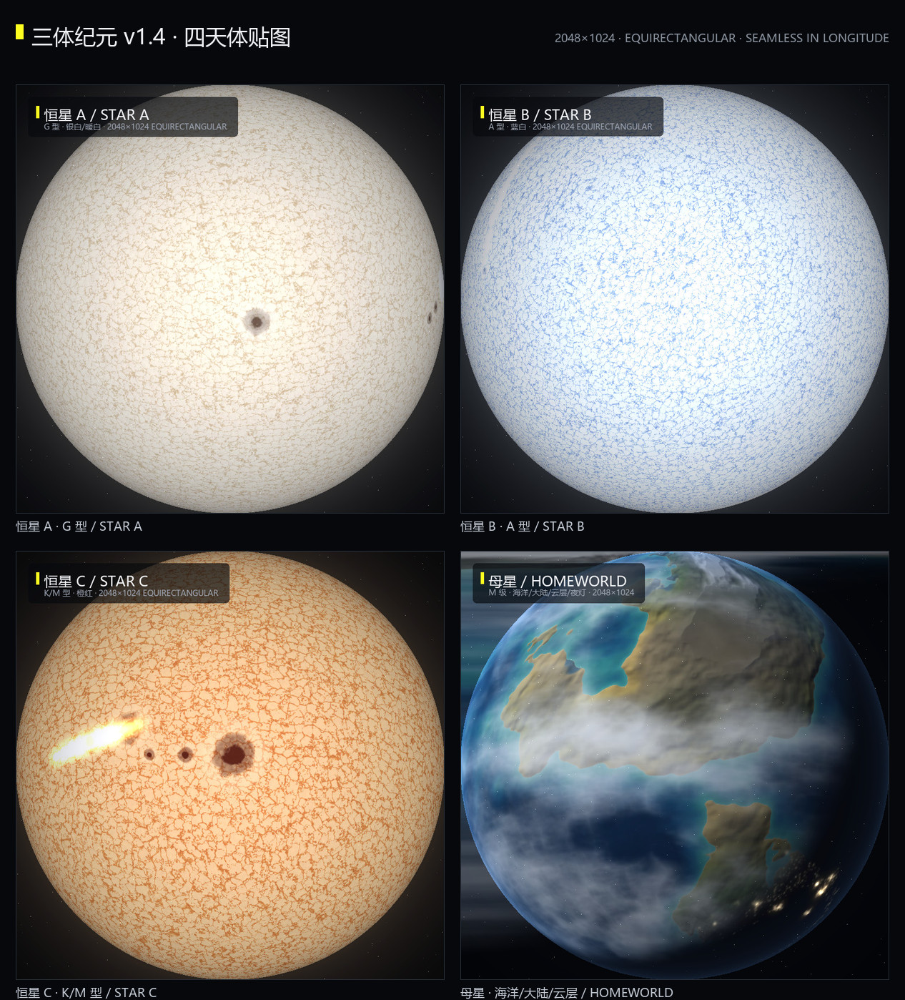
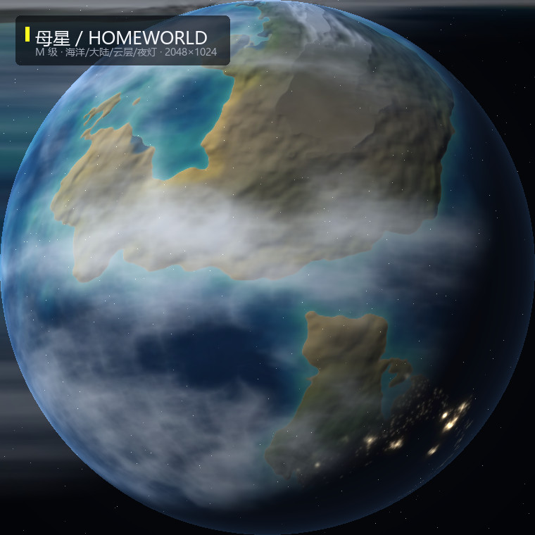
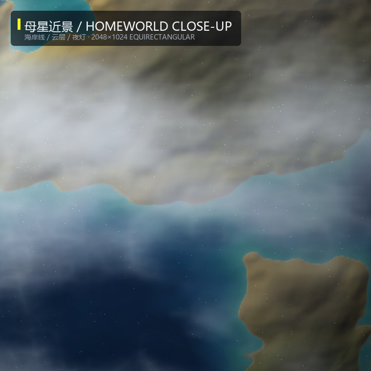
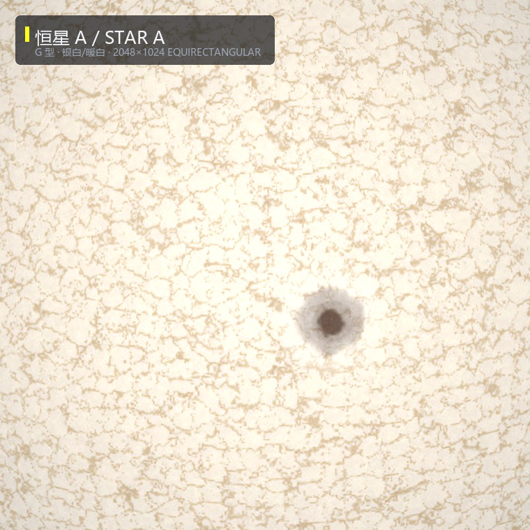
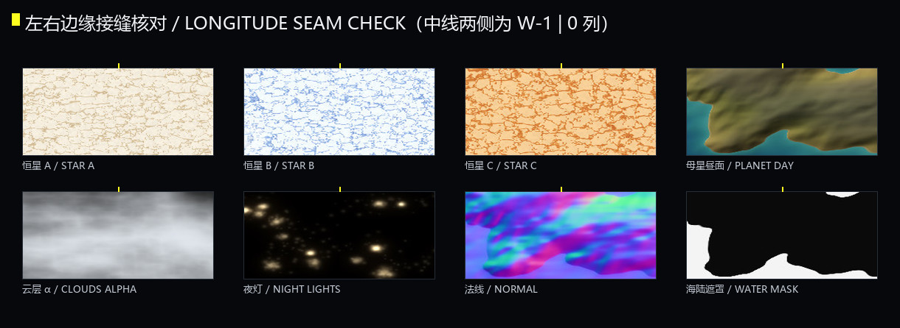

# 美术资产 V4 —— 四天体高清贴图（3D 近景）

> 对应 **v1.4 冻结规格**：docs/V4_SPEC.md §4.1（任务 task-21，owner: texture-art）。
> 机器可读清单：public/textures/manifest.json（路径 / 尺寸 / 字节 / sha256 / 用途 / 无缝校验 / alpha 统计）。
> 生成脚本：scripts/gen-planet-textures.py（**100% 程序化、固定 seed 可复现**，无任何下载或第三方素材）。
> 写入范围：public/textures/**、本文件、scripts/gen-planet-textures.py；**未改动 src/**、package.json、public 其它目录**。
> 集成方：src/render3d/**（texture-3d.ts 的惰性贴图加载器直接读取 manifest.json + 约定路径）。

---

## 1. 交付清单

所有贴图均为 **2048 × 1024 等距圆柱（equirectangular，2:1）**，横向（经度）严格无缝。

| 文件（public/textures/） | 格式 | 尺寸 | 用途 |
| --- | --- | --- | --- |
| star-a.jpg | JPEG 4:4:4 | 2048×1024 | 恒星 A（G 型 · 银白/暖白）：米白-淡金米粒组织、黑子群、光斑、耀斑环 |
| star-b.jpg | JPEG 4:4:4 | 2048×1024 | 恒星 B（A 型 · 蓝白）：青白-淡蓝米粒组织、强耀斑环、暗斑 |
| star-c.jpg | JPEG 4:4:4 | 2048×1024 | 恒星 C（K/M 型 · 橙红）：橙红米粒组织、大黑子、耀斑 |
| planet-day.jpg | JPEG 4:4:4 | 2048×1024 | 母星昼面：海洋深浅 / 大陆生物群系 / 海岸线 / 山脊明暗 / 冰盖 / 湖泊 |
| planet-clouds.png | PNG RGBA | 2048×1024 | 母星云层：**直通 alpha（非预乘）**，白/灰白，0=晴空 |
| planet-night.jpg | JPEG 4:4:4 | 2048×1024 | 母星夜面：纯黑底 + 暖黄城市灯光（含辉光） |
| planet-normal.jpg | JPEG 4:4:4 | 2048×1024 | **可选**：切线空间法线，近景地形起伏（+X 东 / +Y 北 / +Z 外法线） |
| planet-water-mask.jpg | JPEG 4:4:4 | 2048×1024 | **可选额外**：海陆遮罩（白=水），供海洋高光 / 粗糙度参考 |
| manifest.json | JSON | — | 机器清单：尺寸、字节、sha256、seed、用途、接缝与 alpha 统计、three.js 提示 |
| preview/contact-sheet.jpg | JPEG | 1266×1398 | 四天球体预览接触表（验收截图） |
| preview/star-a.jpg、star-b.jpg、star-c.jpg | JPEG | 760×760 | 单天体球体预览 |
| preview/star-a-closeup.jpg、planet.jpg、planet-closeup.jpg | JPEG | 760×760 | 近景预览（米粒组织 / 黑子 / 海岸线 / 云层） |
| preview/seam-check.jpg | JPEG | 1220×446 | 左右边缘接缝核对图（赤道带 W-96…W-1 与 0…95 列拼接） |

> preview/** 只作验收与文档证据，**游戏运行时不引用**。发布减包可删除，脚本 --preview-only 可随时重出。

---

## 2. 纹理坐标约定（**render3d 必读**）

- **u = 经度 / 2π**：图像左边缘 u=0，右边缘 u=1；左右边缘可直接 RepeatWrapping 平铺。
- **v = 纬度**：**图像顶行 = 北纬 90°**，图像底行 = 南纬 90°（与 three.js SphereGeometry UV + 默认 flipY=true 一致）。
- 极点（v=0/1）是等距圆柱投影的固有奇点，贴图在极点附近有投影压缩；**球体渲染时极点不产生接缝**。
- 颜色贴图（day / clouds / night）使用 SRGBColorSpace；planet-normal / planet-water-mask 为数据贴图，**不要**设 sRGB。
- 恒星贴图**不含烘焙临边昏暗**（limb darkening 由渲染器光照/自发光控制），近景时光照一致、不会出现"贴图自带暗边"。

```ts
const tex = await new Promise<THREE.Texture>((resolve, reject) =>
  new THREE.TextureLoader().load('/textures/planet-day.jpg', resolve, undefined, reject));
tex.colorSpace = THREE.SRGBColorSpace;
tex.wrapS = THREE.RepeatWrapping;        // 经度周期
tex.wrapT = THREE.ClampToEdgeWrapping;   // 纬度夹取
tex.anisotropy = Math.min(8, renderer.capabilities.getMaxAnisotropy());
```

### manifest.json 结构

```json
{
  "version": "v1.4",
  "resolution": {"width": 2048, "height": 1024, "projection": "equirectangular",
                 "vOrigin": "image top = north pole (lat +90 deg)"},
  "textures": [
    {"key": "star-a", "path": "public/textures/star-a.jpg", "url": "/textures/star-a.jpg",
     "width": 2048, "height": 1024, "bytes": 0, "sha256": "…", "seed": 0,
     "usage": "…", "seam": {"wrapMeanAbsDiff": 0, "adjacentMeanAbsDiff": 0, "ratioVsAdjacent": 0},
     "luminance": {"mean": 0, "std": 0, "max": 0, "p99": 0, "p999": 0, "brightFraction": 0}},
    {"key": "planet-clouds", "…": "…",
     "alpha": {"channels": 4, "min": 0, "max": 240, "mean": 0.31,
               "transparentFraction": 0.4, "opaqueFraction": 0.0, "premultiplied": false}}
  ],
  "threeJsHints": {"cloudLayer": "…", "nightLights": "…", "lazyLoad": "…"}
}
```

---

## 3. 生成方法（全程序化）

### 3.1 噪声内核

| 内核 | 实现 | 用途 |
| --- | --- | --- |
| 3D 球面值噪声 | 整数 lattice 哈希（uint32 wrap）+ 五次平滑插值，**直接在单位球方向 (px,py,pz) 采样** | 恒星温度/湍流/极区云；天然无接缝、无极点奇点 |
| 3D Worley F1/F2 | 3×3×3 邻域抖动元胞，坐标先做 fBm 域扭曲 | 恒星光球**米粒组织**：F2−F1 细暗通道 + F1 亮米粒内部 |
| 2D 经度周期值噪声 | 整数格点 x % nx 回绕 + 五次平滑 | 行星高程 / 湿度 / 云层 / 细节；**u 方向严格周期** |
| 2D fBm | 多倍频（gain 0.5–0.55，lacunarity 2），可 ridged | 大陆、山脉、云带、气旋 |
| 低分辨率位移场 | 半分辨率气旋旋转 + 双线性 resize_wrap 放大 | 云层大尺度涡旋（省算力且平滑） |

所有场为 numpy.float32 计算，Pillow 编码。**地形/温度/湿度/云/夜灯全部由 20261121 固定 seed 派生**（每资产再叠加 sha256("trisolaris-v14-"+key) 前缀，互不相关但完全可复现）。

### 3.2 三颗恒星（gen_star）

流程：大尺度温度 fBm（3 oct）→ 域扭曲 Worley 米粒组织（gran_freq 22–30）→ 黑子活动区（本影/半影径向剖面 + 噪声明暗 + 光斑环）→ 耀斑环（Bezier 弧上 26 个高斯珠链，低分辨率求值后放大）→ 细纹理/磁亮点调制 → 调色板 LUT → JPEG q90 4:4:4。

| 资产 | 谱型 | 米粒 freq | 对比度 | 活动区 / 黑子 | 耀斑 | 调色板关键色 |
| --- | --- | --- | --- | --- | --- | --- |
| star-a | G 型 银白/暖白 | 26 | ×1.28 | 3 区 × 2–4 个，半径 0.022–0.085 rad | 2 条 | 米粒 #F8F0E0 / 暗通道 #CEB286 / 黑子 #4A3020 |
| star-b | A 型 蓝白 | 30 | ×1.50 | 2 区 × 2–3 个，0.018–0.070 rad | 3 条（强） | 米粒 #F2F9FF / 蓝通道 #7694CC / 黑子 #344268 |
| star-c | K/M 型 橙红 | 22 | ×1.00 | 4 区 × 2–4 个，0.028–0.110 rad | 2 条 | 米粒 #FAD29A / 橙红 #C6602C / 黑子 #581C0A |

> 恒星贴图偏亮（平均亮度约 200–235），建议 MeshBasicMaterial 或 MeshStandardMaterial.emissiveMap + emissiveIntensity，再叠加日冕辉光；近景时纹理细节不会因光照过曝而消失。

### 3.3 母星（gen_planet）

1. **大陆（day）**：域扭曲 fBm 低/中频两层（6+6 oct）合成高程 → 按分位数取海平面（**陆地占比 33.5%**）→ 细节噪声 + ridged 山脉 → 山脊只出现在陆地上。
2. **气候**：湿度 = 域扭曲 fBm + ITCZ 赤道湿带 + 中纬湿带 − 副热带干带 + 海岸加成；温度 = 纬度余弦衰减 − 高程降温 + 噪声。
3. **配色**：5×5 **Whittaker 生物群系色板**（冷→热 × 干→湿）双线性采样 → 岩石/雪线/沙滩/冰盖/湖泊 → 海洋按深度渐变（浅绿松石→深海军蓝）+ 海岸浅滩。
4. **近景细节**：细/极细两级 fBm 调制 ±20%，并按高程梯度烘焙**轻微地形明暗**（海洋近乎平坦），使 2048 贴图在近景仍有地貌起伏感。
5. **冰盖**：极区用 **3D 球面噪声**决定冰缘并抑制极区细节，避免等距圆柱极点出现放射状拉丝。
6. **云层（planet-clouds.png）**：11 个气旋的旋转位移场 + 域扭曲 fBm（7 oct）+ ridged 丝缕（6 oct）+ 卷云；弱纬度环带仅作调制；**极区改用 3D 噪声**；alpha 直通、RGB 近白。
7. **夜面（planet-night.jpg）**：以「陆地 × 近海 × 中低纬 × 低海拔 × 湿度」为权重抽 165 个都市中心，每都市 14–56 颗卫星城 + 3200 个散点村镇，高斯 splat 后做 3 级高斯辉光（暖黄 #FFD68A / #FFB85C），背景纯黑。
8. **法线/水遮罩（可选）**：法线由高程梯度求切线空间法线（海洋近平坦）；水遮罩 = 1 − 陆地。

---

## 4. 复现命令

> 使用项目内置 Python（load_workspace_dependencies 提供的 dependencies/python/python.exe，含 numpy 2.3 / Pillow 12）。下文以 python 代指该解释器。

```powershell
# 全部重生成（贴图 + 预览 + manifest + 自检）
python scripts/gen-planet-textures.py

# 指定 seed / 分辨率（默认 20261121 / 2048×1024）
python scripts/gen-planet-textures.py --seed 20261121 --size 2048

# 只重生成部分（star-a,star-b,star-c,planet）
python scripts/gen-planet-textures.py --only star-a,planet

# 只出贴图、不渲染预览
python scripts/gen-planet-textures.py --no-preview

# 按磁盘上已有贴图重出预览 + 校验 + manifest
python scripts/gen-planet-textures.py --preview-only

# 快速 QA：1024×512 跑一遍（约 1/4 时间），确认结构后再跑 2048
python scripts/gen-planet-textures.py --size 1024
```

运行时间参考（本机，多 agent 并发时约翻倍）：星 A/B/C 各约 45–65 s，母星约 100–170 s，预览+校验约 20 s，总计 **7–10 分钟**；无 npm 依赖、不占用 5173/4173。

---

## 5. 自检与验收

### 5.1 检查项

- **真实尺寸**：Pillow 打开实际文件读取 width×height（不信任生成参数），必须 **2048×1024**。
- **JPG 有效**：亮度 mean/std/max 统计，非全黑、非空白；夜面图用「亮像素比例 / max」判定灯光存在。
- **PNG alpha 正确**：RGBA 四通道、min=0（存在完全透明晴空）、max≥200（存在厚云）、mean 在 0.15–0.65 之间、premultiplied=false。
- **左右无缝**：取 col 0 与 col W-1（本应在球面上相邻）的逐通道平均绝对差，与「正常相邻列平均差」比较；比值 ≈1 说明边缘不存在阶跃，只余 JPEG 噪声。另给出「无关列」对照值数量级证明。**判定：wrap ≤ 2×adjacent + 2.5 且 wrap ≤ 14/255。**
- **独立 Node 校验**：用 Node 直接读文件头（PNG IHDR / JPEG SOF 标记）复核尺寸，避免生成器自证。

### 5.2 校验结果（由 manifest.json 自动生成）

| 资产 | 尺寸 | 字节 | wrap 均值差 | adjacent 基线 | ratio | 亮度 mean / max | 结论 |
| --- | --- | --- | --- | --- | --- | --- | --- |
| star-a（G 型 银白/暖白） | 2048×1024 | 947.5 KB | 9.00 | 9.33 | 0.97 | 229.9 / 255 | PASS |
| star-b（A 型 蓝白） | 2048×1024 | 1453.9 KB | 14.01 | 13.39 | 1.05 | 234.7 / 255 | PASS |
| star-c（K/M 型 橙红） | 2048×1024 | 1332.1 KB | 13.34 | 12.82 | 1.04 | 196.7 / 255 | PASS |
| planet-day（母星昼面） | 2048×1024 | 259.4 KB | 1.43 | 1.19 | 1.21 | 85.7 / 235 | PASS |
| planet-clouds（云层 RGBA） | 2048×1024 | 612.2 KB | 0.27 | 0.21 | 1.30 | 240.0 / 241 | PASS； alpha mean=0.2644（min=0, max=240, 直通非预乘） |
| planet-night（夜面灯光） | 2048×1024 | 87.1 KB | 0.12 | 0.40 | 0.31 | 2.2 / 255 | PASS； max=254.7, 亮像素=0.94% |
| planet-normal（可选法线） | 2048×1024 | 613.1 KB | 3.52 | 3.27 | 1.08 | 137.4 / 215 | PASS |
| planet-water-mask（可选海陆遮罩） | 2048×1024 | 88.2 KB | 1.10 | 0.95 | 1.16 | 165.6 / 255 | PASS |

- 全部 **8 项 PASS**；贴图文件总计 **5.27 MB**（不含 preview 预览图）。
- 独立 **Node 文件头校验**（不经过 Pillow 生成器）：8 个文件全部 `2048×1024`，云层 PNG 为 `colorType=6 (RGBA) / bitDepth=8`。
- 云层 alpha：`{"channels":4,"min":0,"max":240,"mean":0.2644,"transparentFraction":0.1892,"opaqueFraction":0,"premultiplied":false}`；透明像素占比 18.9%，无 100% 不透明像素（避免塑料感）。
- manifest 生成时间：2026-11-21T21:23:46+08:00，seed：20261121，共 8 项纹理 + 6 张预览。

> 说明：wrap 与 adjacent 同为 1 像素间隔的均值差，ratio≈1 即左右边缘与内部任意相邻列的无缝程度一致；unrelated 为第 0 列与第 W/2 列的差值，数量级远大于 wrap，证明不存在色阶/亮度阶跃。接缝可视化见 preview/seam-check.jpg。

---

## 6. 引用方式与性能

| 贴图 | three.js 用法 |
| --- | --- |
| star-a/b/c.jpg | 恒星球体 MeshBasicMaterial({ map }) 或 MeshStandardMaterial({ emissiveMap, emissive:0xffffff, emissiveIntensity })；配合外层日冕 glow / 菲涅尔壳 |
| planet-day.jpg | 母星球体 MeshStandardMaterial.map（sRGB）；PBR / Phong 均可 |
| planet-clouds.png | **独立云球**：半径 = 行星半径 × 1.012，map + transparent:true + depthWrite:false + opacity≤0.95；直通 alpha（非预乘） |
| planet-night.jpg | 夜面：emissiveMap（MeshStandardMaterial）或黑底叠加 AdditiveBlending；用 1 − dayFactor 控制强度，避免污染昼面 |
| planet-normal.jpg（可选） | normalMap + normalScale（若绿色通道方向相反设为 (1, -1)） |
| planet-water-mask.jpg（可选） | roughnessMap（需取反）或海洋高光强度遮罩；可替代运行时的颜色推导高光（deriveOceanSpecularMap） |

- **惰性加载**：仅当天体进入近景 / 首次点击时才 TextureLoader.load；全景模式零请求（texture-3d.ts 已按此实现，且 manifest 路径优先、/textures/<stem>.jpg|png 回退）。
- **显存/带宽**：8 张 2048 纹理合计约 5.3 MB（其中云层 PNG 约 0.6 MB）；三颗恒星均为自发光，无需 PBR 环境光贴图。
- **各向异性**：近景建议 anisotropy = min(8, maxAniso)，经度方向 RepeatWrapping，mipmap 开启。
- **降级**：WebGL 不可用时仍由 texture-3d.ts 走程序化回退材质，本贴图目录不参与 2D 渲染。

---

## 7. 预览图

**四天体球体预览（验收用）**



**母星（昼面 + 云层 + 夜面 + 大气边缘光）与近景**




**恒星 A 近景（米粒组织 / 黑子半影）**



**左右边缘接缝核对（每格中线为 W-1 | 0 列，黄色刻度指向接缝）**



> 预览渲染由同脚本完成：正交投影球体 + 简化光照（恒星临边昏暗 + 自发光辉光；母星方向光 + 云层 alpha 合成 + 夜面灯光 + 菲涅尔大气边缘），仅用于展示纹理实际映射效果，不是游戏内渲染。

---

## 8. 来源与版权

- **100% 程序化生成**：scripts/gen-planet-textures.py（Python 3 + numpy + Pillow），不含任何下载素材、AI 生成图、第三方纹理或字体（预览图中的 UI 文字使用系统字体绘制，不进入游戏资源）。
- 生成参数、seed、每张图的 sha256 全部记录在 public/textures/manifest.json，可逐字节复现。
- 资产随本项目分发；如需在其它项目使用，请保留本文件的方法与来源说明。

## 9. 已知缺口 / 注意

- 等距圆柱的极点压缩是投影固有特性（贴图极点附近可见压缩），球体渲染无接缝；若未来需要极点特写，可换 cubemap / 三平面映射。
- 云层 alpha 上限 0.94（不留 100% 实心云，避免近景塑料感）；JPEG 为有损压缩（4:4:4，q90/92），近景极端放大会有轻微块效应——内置 mipmap 足以覆盖游戏内近景。
- 恒星贴图偏亮、不含临边昏暗，最终亮度由渲染器自发光强度决定；如 UI 需要更暗的恒星，请在材质上调 emissiveIntensity，不要改贴图。
- 恒星耀斑为贴图内的高亮弧带（A/C 明显，B 为细蓝白弧带，球体远景视角下可能不显眼）；近景建议在渲染器叠加一层日冕/耀斑 glow 以强化「强耀斑」的观感。
- planet-normal.jpg / planet-water-mask.jpg 为可选附加资产；render3d 未使用时不影响验收。
- 2026-11-21 生成档：详见 manifest 的 generatedAt 与 seed。
